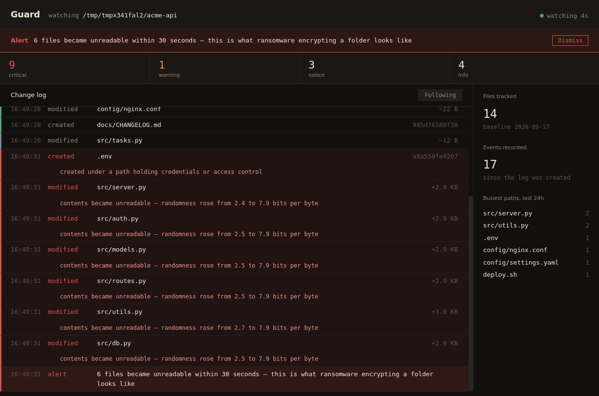

# Guard 3.0.0

**File integrity monitoring in one Python file.** Guard watches a directory, verifies actual file changes, rates their severity, keeps an SQLite event history, and can detect a burst of files becoming unreadable — a pattern associated with ransomware encryption.

The complete application lives in **`app.py`**. The live dashboard's HTML, CSS, and JavaScript are embedded in that file too, so there are no separate application modules or dashboard assets to keep in sync.



## What Guard does

### Real-time monitoring

Guard uses filesystem notifications as hints, not proof. It waits until a file has been quiet for a short period, fingerprints it, and compares it with the last recorded state. Repeated notifications and identical-content saves are discarded instead of filling the log with noise.

### File fingerprints

For regular files within the configured hashing limit, Guard records:

- File size and SHA-256 hash
- Permission bits, including whether the file is executable
- Modification time
- Shannon entropy from a small sample of the file

Large files are tracked by size, permissions, and timestamp without reading the entire file for a hash. This avoids stalling the watcher on very large media or archive files.

### Severity and reasons

Each confirmed change receives a severity and an explanation:

| Level | Typical examples |
| --- | --- |
| Critical | Sensitive credential paths, a file gaining execute permission, or readable content becoming high-entropy |
| Warning | Deleted files, executable files, permission changes, or major truncation |
| Notice | New files, renamed files, and configuration-file changes |
| Info | Other verified content changes |

### Ransomware-pattern heuristic

Guard watches for multiple distinct files becoming high-entropy within a configurable time window. Already-compressed formats such as common images, videos, and archives are excluded. The heuristic is a warning signal, not a malware scanner or proof of ransomware.

### Baseline and offline audit

`baseline` fingerprints the current directory tree. `audit` compares the current tree with the stored fingerprints and reports added, changed, or removed files. Permission changes are detected even when the file bytes remain identical. The audit command exits with status `1` when differences are found, making it usable in scheduled checks and CI.

### SQLite history and dashboard

Every confirmed event is stored in SQLite. The `history` and `stats` commands can query that history. The optional local dashboard shows recent events, severity totals, uptime, tracked-file count, and frequently changed paths. It polls the local HTTP API once per second and needs no frontend build tools or framework.

## Requirements

- Python 3.10 or newer
- `watchdog` for real-time filesystem monitoring
- SQLite is included with Python; no separate database server is required

On Windows PowerShell:

```powershell
cd p4_Guard
python -m venv .venv
.\.venv\Scripts\Activate.ps1
python -m pip install -r requirements.txt
```

On macOS or Linux:

```bash
cd p4_Guard
python3 -m venv .venv
source .venv/bin/activate
python -m pip install -r requirements.txt
```

## Run Guard

Run all commands through the single application file:

```bash
python app.py --version
python app.py --help
```

### Watch a directory

```bash
python app.py watch ./project
python app.py watch ./project --dashboard
python app.py watch ./project --dashboard --no-browser
python app.py watch ./project -m warning
python app.py watch ./project -i '*.log'
```

The dashboard defaults to `http://127.0.0.1:8420`. It binds to loopback by default, so it is only available on the local machine. Avoid binding it to a public interface unless you have separately secured access to it.

### Create and check a baseline

```bash
python app.py baseline ./project
python app.py audit ./project
```

Guard stores fingerprints and event history in `guard.db` by default. Choose another database path with `-d`:

```bash
python app.py baseline ./project -d ./data/guard.db
python app.py audit ./project -d ./data/guard.db
```

Use the same database path for related commands.

### Review history and statistics

```bash
python app.py history ./project -n 50
python app.py history ./project -p src/ -m warning
python app.py stats ./project
```

### Use audit in a scheduled check

An audit exits `1` when differences are found and `0` when the tree matches the stored fingerprints:

```bash
python app.py baseline ./project -d ./guard.db
python app.py audit ./project -d ./guard.db
```

## Project layout

```text
p4_Guard/
├── app.py             # Entire application, including the dashboard
├── requirements.txt   # Runtime dependency
├── README.md
├── LICENSE
├── dashboard-preview.png # optional project screenshot
└── tests/
    └── test_app.py    # Regression tests; not part of the runtime app
```

There are no separate `guard/` modules and no `dashboard.html` file. The test file is kept separate so the application itself remains a single file.

## Tests

Install development tools and run the regression suite:

```bash
python -m pip install pytest ruff
python -m pytest -q
ruff check app.py tests/test_app.py
```

The tests cover entropy, fingerprints, ignore rules, severity decisions, noise filtering, moves, ransomware-pattern detection, baseline/audit, SQLite storage, formatting, and real filesystem events. The two end-to-end watcher tests require `watchdog` to be installed.

## Important limitations

Guard is a lightweight file-integrity monitor. It does not prevent writes, quarantine files, recover encrypted files, or replace antivirus/endpoint detection software. High entropy alone is not proof of ransomware. Keep independent backups of important data.

## License

MIT. See [LICENSE](LICENSE).
